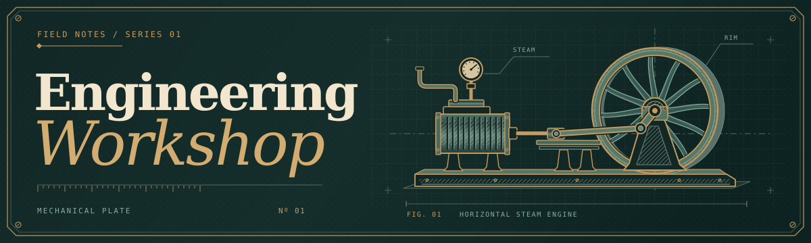

# Justin · Applied AI

I build tools that let people inspect what an AI system did. A retrieved passage, a failed tool call, or a changed number in a draft should be easy to find and check.

## On the workbench

**01 [Evidence RAG Bench](https://github.com/SCUliujiacheng/evidence-rag-bench)**  
When does a search result actually answer the question? Compare three retrievers on English and Chinese documents. One English experiment improved the rank of the first relevant passage while missing more of the relevant passages in the top three. [See the results](https://github.com/SCUliujiacheng/evidence-rag-bench/blob/main/docs/benchmark-results.md) · [中文](https://github.com/SCUliujiacheng/evidence-rag-bench-zh)

**02 [Agent Reliability Lab](https://github.com/SCUliujiacheng/agent-reliability-lab)**  
Follow a timed-out tool call from failure to retry, or restart a run while it waits for approval. Six scripted scenarios keep the inputs fixed so you can inspect exactly what changed. [Inspect the traces and results](https://github.com/SCUliujiacheng/agent-reliability-lab/blob/main/docs/benchmark-results.md) · [中文](https://github.com/SCUliujiacheng/agent-reliability-lab-zh)

**03 [Paper Rewrite](https://github.com/SCUliujiacheng/paper-rewrite)**  
A local review desk for Chinese and English drafts. Compare a revision with the source paragraph and see which numbers, units, or citations need another look. [Read the evaluation](https://github.com/SCUliujiacheng/paper-rewrite/blob/main/docs/evaluation.md) · [中文](https://github.com/SCUliujiacheng/paper-rewrite-zh)

## Other builds

[**Live Companion · 直播搭子**](https://github.com/SCUliujiacheng/live-companion) — a browser sidebar that listens to a Bilibili stream and drafts a reply for the viewer.  
[**Small Business Ledger · 小本账**](https://github.com/SCUliujiacheng/small-business-ledger) — a local ledger for sales, costs, and partial payments.
