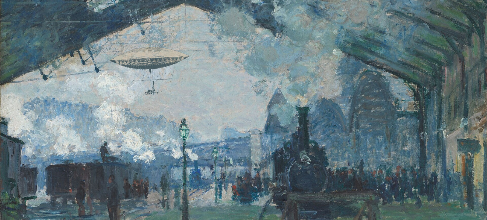
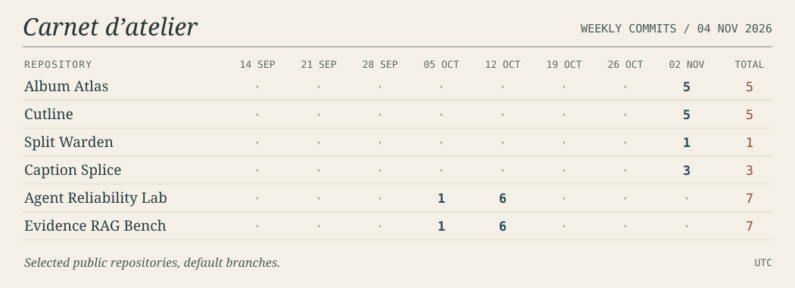

《圣拉扎尔，另一条航线》 · 封面拼贴 · [作品与素材](./assets/ART-CREDITS.md)

## Hello，我是 Justin

我做可以直接上手的 AI 工具，也喜欢追问它们在哪些例子上会出错。目前关注 **AI 应用开发与机器学习实习**。

- **正在做** · [相册罗盘 Album Atlas](https://github.com/SCUliujiacheng/album-atlas)。给它几张相册样片，它会在浏览器里给新照片找位置。[打开工作台 ↗](https://sculiujiacheng.github.io/album-atlas/)
- **喜欢拆解的问题** · 检索到的段落能回答问题吗？工具调用超时后，重试会做两次同一件事吗？我把这些问题做成了能复跑的实验。
- **English** · I build local-first AI tools and test where their predictions break. I’m looking for an applied AI or machine learning internship.

## 近期工坊记录 · Workshop log

面板记录下列四个公开仓库默认分支的每周提交次数。最右侧为总数，当前周截至图中标注的 UTC 日期。

## 作品陈列 · Selected builds

| 作品 | 值得点开看的地方 |
| :--- | :--- |
| **[Album Atlas · 相册罗盘](https://github.com/SCUliujiacheng/album-atlas)** | 用同一批照片比较几种整理方式，看看哪些照片需要人来决定。[在线试用](https://sculiujiacheng.github.io/album-atlas/) · [模型实测](https://github.com/SCUliujiacheng/album-atlas/blob/main/docs/model-evaluation.md) |
| **[Agent Reliability Lab](https://github.com/SCUliujiacheng/agent-reliability-lab)** | 在六个固定场景里重放超时、限流和审批中断，观察两种策略如何恢复。[实验结果](https://github.com/SCUliujiacheng/agent-reliability-lab/blob/main/docs/benchmark-results.md) · [中文](https://github.com/SCUliujiacheng/agent-reliability-lab-zh) |
| **[Evidence RAG Bench](https://github.com/SCUliujiacheng/evidence-rag-bench)** | 有引用也可能答非所问。在中英文语料上对照排名、原文证据和拒答结果。[检索对照](https://github.com/SCUliujiacheng/evidence-rag-bench/blob/main/docs/benchmark-results.md) · [中文](https://github.com/SCUliujiacheng/evidence-rag-bench-zh) |
| **[Paper Rewrite · 改稿台](https://github.com/SCUliujiacheng/paper-rewrite)** | 逐段对照本地改写稿，找出被改掉的数字、单位和引用。[评估记录](https://github.com/SCUliujiacheng/paper-rewrite/blob/main/docs/evaluation.md) · [中文](https://github.com/SCUliujiacheng/paper-rewrite-zh) |
